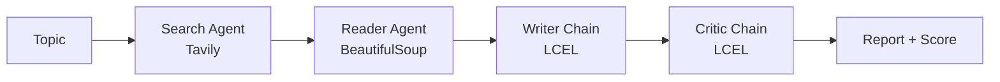

# 🔬 Multi-Agent AI Research System

A multi-agent research assistant built with **LangChain**, **Groq**, **Tavily** and **Streamlit**. Enter any topic and a team of AI agents searches the web, reads the best source, writes a structured report, and then has a critic review it.


## How it works



| Step | Component | Type | What it does |
|------|-----------|------|--------------|
| 1 | Search agent | ReAct agent + `web_search` tool | Writes its own queries and finds relevant sources via Tavily |
| 2 | Reader agent | ReAct agent + `scrape_url` tool | Picks the most relevant URL and scrapes it with BeautifulSoup |
| 3 | Writer | LCEL chain | Turns the gathered research into a structured report |
| 4 | Critic | LCEL chain | Scores the report out of 10 and suggests improvements |

**Design choice:** agents are used where the path isn't fixed (which query to search, which page to scrape), and plain chains are used where the step is always the same (write, review). Chains are cheaper, faster and more predictable than agents for fixed steps.

## Tech stack

- **LangChain**: agents, tools, prompts, LCEL pipelines
- **Groq**: LLM inference (`openai/gpt-oss-120b`)
- **Tavily**: web search API built for AI agents
- **BeautifulSoup + requests**: web scraping
- **Streamlit**: frontend

## Project structure

```
.
├── app.py            # Streamlit frontend
├── pipeline.py       # Connects agents and chains (search -> read -> write -> critique)
├── agents.py         # LLM setup, agents, writer and critic chains
├── tools.py          # web_search (Tavily) and scrape_url (BeautifulSoup) tools
├── requirements.txt
└── .env.example
```

## Getting started

### 1. Clone and create a virtual environment

```bash
git clone https://github.com/parthbisht16september-lang/multi-agent-research-system.git
cd multi-agent-research-system

python -m venv .venv
source .venv/bin/activate
```

### 2. Install dependencies

```bash
pip install -r requirements.txt
```

### 3. Add your API keys

Copy the example file and fill in your own keys:

```bash
cp .env.example .env
```

```
GROQ_API_KEY=your_groq_key_here
TAVILY_API_KEY=your_tavily_key_here
```

- Groq key: https://console.groq.com
- Tavily key: https://tavily.com

> Never commit your `.env` file. It is already listed in `.gitignore`.

### 4. Run it

**Web UI:**

```bash
python -m streamlit run app.py
```

**Terminal only:**

```bash
python pipeline.py
```

## Features

- Live progress for each of the 4 steps
- Critic score, word count and source metrics
- Tabs for the report, critic review, raw search results and scraped content
- Download the report as Markdown

## Known limitations

- The reader scrapes a single URL per run
- JavaScript-heavy sites may return little or no text, since BeautifulSoup only sees raw HTML
- Some sites block scrapers; the agent then relies on the search snippets
- Free-tier API rate limits can interrupt long runs
- Model availability on Groq can differ by account, so change the model name in `agents.py` if you get a "model not found" error

## Roadmap

- [ ] Critic-triggered rewrite loop (re-draft if the score is below a threshold)
- [ ] Scrape multiple URLs per run
- [ ] Rebuild the workflow as an explicit LangGraph graph
- [ ] Save run history and add simple evaluation

## Author

**Parth Bisht**: [GitHub](https://github.com/parthbisht16september-lang)
